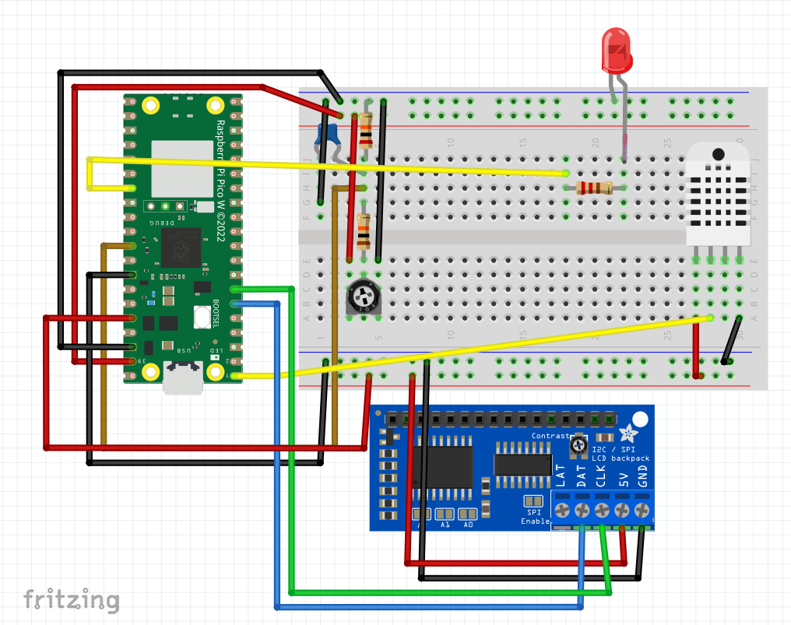
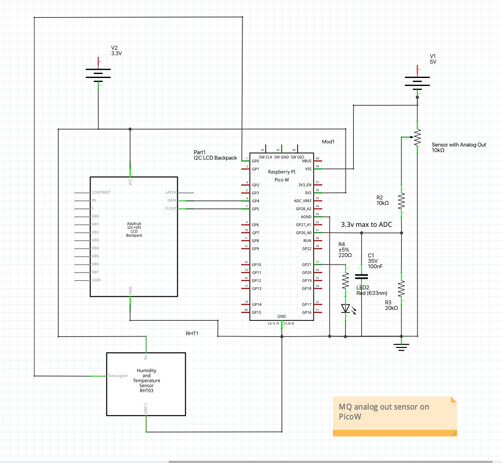

# Project Status Update (February 2026)

We are making steady progress on both the _hardware_ and _data infrastructure_ fronts as we continue developing an environmental monitoring platform tailored to local air quality needs.

### Hardware Prototyping & Architecture Decisions

To explore suitable embedded hardware for our monitors, we built and evaluated two types of prototype systems:

- A **full single-board computer** based on a Raspberry Pi running a complete operating system. This approach made development straightforward with high-level languages and existing libraries, and provided built-in Wi-Fi and storage. However, these boards consume significantly more power and cost more per unit, which matters for long-term outdoor deployments.

- A **microcontroller-based design using the Raspberry Pi Pico W**, a simple board with a microcontroller and Wi-Fi support, but _no operating system_. Compared to traditional Raspberry Pi models:

  - Pico-class microcontrollers typically draw on the order of tens of milliamps of current in active modes (e.g., ~40 mA typical idle with peaks higher when Wi-Fi is active), with deep-sleep modes dropping even lower, making them far more efficient than full Raspberry Pi SBCs which draw watts of power in normal operation. ([Why Pi][1])
  - In terms of unit cost, Pico-class boards retail in the low single-digit dollar range (e.g., around ~$6 for a wireless Pico W), while typical Raspberry Pi single-board computers range from roughly ~$10 for very basic models to $35 or more for general-purpose boards. ([Wikipedia][2])

Although developing at the microcontroller level requires working closer to the hardware and learning lower-level networking stacks, the power and cost advantages of the Pico W architecture make it a better fit for distributed, battery-powered monitors. Based on these tradeoffs, we have standardized our prototype platform around the **Pico W**.

We have built **two prototype units** so far, each integrating:

- Temperature and relative humidity sensing
- An analog metal-oxide (MOX) gas sensor
- Wi-Fi connectivity with MQTT for lightweight, reliable data transmission

These prototypes have allowed us to validate base functionality, firmware workflows, and networking, and have informed early decisions about power, connectivity, and enclosure considerations.

We have not yet deployed these prototypes outdoors. We are still refining our hardware requirements and enclosure design, especially as we plan to move toward higher-quality sensors that may come with different form factor and environmental demands.

### Pollution Targets & Sensor Roadmap

Our research into relevant pollutants was guided by discussions with local industry experts and partners from LSU, LEAN, and other community groups. Based on this input and what matters most for local air quality impacts, we are prioritizing:

- **Hydrogen sulfide (H₂S)**
- **Sulfur dioxide (SO₂)**
- **Methane (CH₄)**

We are currently evaluating sensor technologies that offer improved selectivity and stability for these gases compared to MOX sensors. This includes higher-quality **electrochemical sensors** for sulfur-based pollutants and **NDIR (non-dispersive infrared) sensors** for methane. These next-generation sensors will form the basis of upcoming prototypes focused on higher fidelity measurements.

### Data Infrastructure & Learning from Existing Systems

In parallel with hardware work, we are building out our understanding of large-scale data collection and backend design. We have been studying data practices from existing networks like PurpleAir (for particulate monitoring) and have worked with the PurpleAir API to understand how community sensor data is structured and ingested.

Lessons from these systems are informing our backend architecture. Our goal is to build:

- A secure, scalable ingestion service for device data
- A structured time-series database
- A public REST API
- Map-based visualization tools
- Data sharing integrations with community partners, including LEAN

The backend is currently **in design** and will be further developed as our prototype fleet scales and sensor requirements solidify.

### Team Growth

To accelerate both prototype development and backend implementation, we have onboarded **three apprentices** who will begin work in the next few weeks. They will be focused on expanding our prototype builds, refining firmware, and advancing the backend services.

---

If you want, I can follow this with a short _milestones & next steps_ section (with dates/targets) for funders that prefer a plan-forward view. Just let me know!

[1]: https://www.whypi.org/what-are-the-power-requirements-for-the-raspberry-pi-pico/ "What Are the Power Requirements for the Raspberry Pi Pico? ⚡️ (2025)"
[2]: https://en.wikipedia.org/wiki/Raspberry_Pi "Raspberry Pi"
