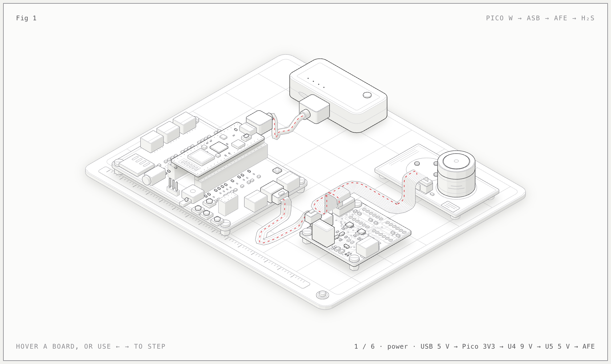

# Project Status Update (October 2026): Electrochemical Sensor Interface Boards

**Status as of October 23, 2026:** We have ordered **five Smart Citizen 8-channel analog sensor board (ASB) PCBs from JLCPCB** to build and evaluate the Alphasense sensor-node setup shown below. This is an order milestone, not confirmation of delivery, completed assembly, working firmware, calibrated measurements, or outdoor deployment.

## Why This Hardware Matters

Operation Spark and shift7 are developing LouisianAir with apprentices and students to support a DIY network of 5–10 low-cost air-quality nodes in frontline New Orleans communities. The goal combines community access to environmental data with practical training in electronics, firmware, APIs, and open-source documentation.

The August 2026 program update identified a specific blocker: although we had acquired Alphasense H₂S and SO₂ sensors, we lacked the interface hardware needed to connect their analog measurement chain to our microcontrollers. The team contacted Alphasense technical support and Fab Lab Barcelona in early October; the Smart Citizen ASB provides an existing open-hardware design to evaluate rather than designing this entire interface from scratch. The five-PCB order advances the hardware-design and BOM work discussed at the October 21 team sync.

**The ASB is the bridge between the Alphasense analog front end and the Pico W—not a replacement for either one.** The parts have distinct jobs:

- The **electrochemical gas sensor** produces a very small current in response to gas exposure.
- The **Alphasense analog front end (AFE)** provides the sensor's operating circuitry and converts electrode currents into analog voltages.
- The **Smart Citizen ASB** digitizes those voltages, provides I²C level shifting, and includes the power-conversion circuitry for the illustrated AFE supply.
- The **Pico W** runs the firmware that reads the ADCs, applies validated calibration and compensation, and sends readings to LouisianAir.

A bare sensor cannot simply be connected to a Grove port, and an AFE's analog outputs are not digital readings that the Pico can read over I²C. The ASB fills that missing analog-to-digital and electrical-interface role.

## Node Layout Being Built

*Design illustration, not a photograph of an assembled or deployed node. The battery pack represents the bench power source; field power and runtime still need validation.*

The illustrated build uses the **8-channel step-up version**, with two ADS1115 16-bit ADCs. The Maker Pi Pico base's **Grove 5** port carries GP8/SDA, GP9/SCL, ground, and 3.3 V to ASB connector **J2**. The diagram expects ADC addresses **0x48 and 0x49**; these must be checked against the assembled boards' address configuration.

The ASB's step-up/regulator path is designed to derive a 5 V ADC/AFE supply from the Grove input while keeping the Pico-facing I²C interface at 3.3 V. ASB connector **J5** connects to the Alphasense two-way AFE using a **2 mm-pitch, 2×5 ribbon connection**. Verify the actual mating connectors, pin-1 orientation, and pinout before applying power; a generic 2.54 mm IDC cable is not interchangeable.

The diagram shows an H₂S sensor in **SN1**. It requires a compatible **four-electrode A4-series sensor and an AFE configured for that sensor and socket**; a three-pin H2S-A1 is not a drop-in substitute. Confirm the exact part numbers of the sensors and AFEs on hand before assembly. SO₂ remains a target, but this illustration does not establish a validated dual-gas configuration. Eight analog inputs do not mean eight gas sensors or eight simultaneous measurements: electrode and temperature signals consume channels, and each ADC multiplexes its inputs.

### Relationship to Earlier Hardware Paths

The August update described a parallel XIAO ESP32S3 / Wio-SX1262 / SGP41 path while electrochemical integration was blocked. This order reopens the Alphasense development path using **Pico W and I²C**; the diagram does not show a LoRa radio or prove that firmware and power designs transfer between those platforms. SGP41 VOC/NOx indices are not substitutes for H₂S, SO₂, or methane concentration measurements. Methane still requires its own sensing hardware.

[ADR-0006](../adr/0006-sulfur-gas-sensor-afe-architecture.md) records an earlier **proposed SPI/ADS1220** interface. The ordered ASB instead uses **I²C/ADS1115**. This update documents the build under evaluation; it does not claim the earlier ADC choice or its accuracy targets have been validated by the new board. The final interface decision must follow bench and field evidence.

## Why We Need the Boards for Development

- **Unblock real sensor integration.** Exercise the complete sensor → AFE → ADC → firmware path using a repeatable PCB instead of rebuilding power, conversion, and signal wiring on each breadboard.
- **Develop against the hardware we intend to use.** Implement and verify TinyGo ADS1115 acquisition, ADC configuration, channel mapping, and I²C communication. An ADS1220 SPI driver does not operate these boards.
- **Evaluate measurement quality.** Record raw ADC counts and voltages; establish baseline stability, noise, supply behavior, temperature response, and usable resolution. A 16-bit ADC specification alone does not establish ppb-level accuracy.
- **Make apprentice work reproducible.** Use a common layout for assembly instructions, debugging, firmware work, and the DIY playbook, with fewer loose-wire differences between builds.
- **Compare multiple units.** Five boards allow repeated builds and side-by-side checks rather than relying on one successful prototype. Their eventual allocation between bench work, spares, and field nodes depends on assembly yield and validation; no allocation is committed here.

## Why the Interface Remains Necessary in Final Deployment

The need to condition and digitize electrochemical signals does not disappear after prototyping. If this design passes validation, an assembled ASB is intended to remain in **each electrochemical node** as its permanent AFE-to-microcontroller interface. Otherwise, a replacement interface must provide the same functions; firmware alone cannot replace this circuitry.

A soldered PCB with defined connectors is a more repeatable basis for mounting, servicing, and reproducing nodes than the breadboards and jumper wires used in the indoor workshops. That addresses a known weakness of the educational prototypes, which were intentionally not deployed outdoors.

**A PCB is necessary for this build, but is not by itself an outdoor-ready sensor.** The board does not provide a weatherproof enclosure, controlled airflow, condensation protection, cable strain relief, calibration, or a verified power budget. The Maker Pi Pico base and USB pack are development conveniences, not yet a frozen field BOM. Final deployment remains conditional on those mechanical, electrical, measurement, and communications checks.

## BOM Update: Illustrated H₂S Node

Quantities below describe **one illustrated node**, not confirmed purchases of complete kits. The only new order confirmed by this update is the batch of five ASB PCBs. Prices, delivery timing, and the supplier's populated-versus-bare-board scope are not recorded here; verify the order before treating the boards as ready to plug in.

| Item | Quantity per illustrated node | Role / procurement note |
| --- | --- | --- |
| Smart Citizen 8-channel step-up ASB | 1 | Five PCBs ordered from JLCPCB. Confirm population and inspect assembly before bring-up. |
| ADS1115 ADCs, I²C level shifters, DC-DC converter, regulator, connectors, and passives | 1 board population | Components on the ASB, not additional ADC breakout boards. Two ADS1115s per ASB; verify fitted parts against the fabrication BOM. |
| Raspberry Pi Pico W | 1 | Firmware and Wi-Fi controller in this layout. |
| Cytron Maker Pi Pico base | 1 | Development carrier exposing the Grove connection. |
| Four-wire Grove cable | 1 | Base Grove 5 to ASB J2; carries power and I²C. |
| Alphasense two-way A-series AFE | 1 | Required separately from the ASB; confirm exact configuration and compatibility. |
| Compatible four-electrode H₂S A4-series sensor | 1 | Illustrated in SN1; verify the acquired sensor's model and AFE socket assignment. |
| 2 mm-pitch, 2×5 ribbon cable and mating connectors | 1 cable assembly | ASB J5 to AFE; verify pitch, gender, pinout, and orientation. |
| USB power source and Pico-compatible USB cable | 1 set | Bench supply shown; measure field power demand and select the deployment supply separately. |
| Digital ambient temperature / humidity sensor | To select | Needed for environmental context and compensation evaluation; not shown in this diagram. |
| Enclosure, mounts, sensor air inlet, and cable protection | 1 deployment assembly | Must be designed and validated for field conditions; not supplied by the ASB order. |

The five boards support an initial five-board build batch, **not five completed or deployed nodes**. Reaching the full 5–10-node program goal also requires the remaining components, successful validation, and additional interface boards if more than five nodes use this design.

## Next Milestones and Deployment Gates

1. **Receive and inspect the order.** Confirm board revision, assembly scope, fitted parts, soldering, connector compatibility, and sensor/AFE models; complete missing population before powered tests.
2. **Bring up power safely.** Check for shorts and verify the supply configuration, regulated rails, I²C logic levels, and total load against the Pico/base and converter limits before connecting the AFE. Measure noise and voltage stability with the intended load and Wi-Fi activity.
3. **Validate acquisition and reporting.** Detect both ADCs, verify the AFE-to-ADC map including working/auxiliary electrode and temperature signals, and publish identifiable, timestamped readings through the existing MQTT ingestion path. Preserve raw values so conversion errors can be investigated.
4. **Validate concentration estimates.** Apply the specific sensor's calibration data, AFE gains/offsets, and appropriate temperature compensation. Evaluate humidity effects, cross-sensitivity, drift, and comparison with a suitable reference before describing outputs as reliable pollutant concentrations. Keep unvalidated measurements clearly labeled.
5. **Qualify the field assembly.** Compare enclosed and unenclosed behavior, check airflow and temperature/humidity effects, test power runtime and communications reliability, and protect electronics from weather while allowing gas to reach the sensor. A 3D-printed case alone is not proof of weather resistance.
6. **Release a reproducible build.** Record the tested board revision, final BOM and costs, wiring, firmware configuration, calibration procedure, and maintenance needs in the DIY resources before repeating the build for community deployment.

This work supports community environmental monitoring and education; the order does not establish regulatory-grade measurements or a life-safety gas alarm.

## References and Provenance

- [Smart Citizen Analog Sensor Board documentation](https://docs.smartcitizen.me/hardware/boards/analog-sensor-board/) — upstream board functions, ADCs, voltage handling, and I²C interface.
- [Fab Lab Barcelona open-hardware repository](https://github.com/fablabbcn/smartcitizen-analog-sensor-board) — upstream design files. The local fabrication package uses `8-channel/assembly/bom-jlc.csv` and `8-channel/assembly/cpl-jlc.csv`; these are more specific to this order's intended population than the upstream overview, but are not evidence of what the supplier has assembled.
- The layout image is copied from `connection-diagram/connection-light.png` in the hardware working copy; its companion `connection-light.html` and `build.mjs` document the intended connections. Treat the layout as a design reference, not a test result.
- [February 2026 project update](feb-2026.md), the supplied August 2026 program update, and October 2 / October 21 team notes provide the program history and order context.
